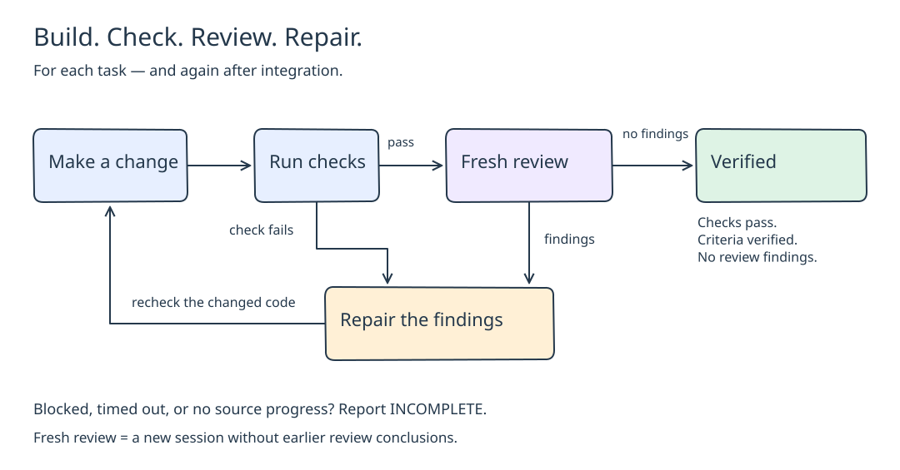

# Software Factory

A skill for coding agents. Every explicit software-factory request goes to one place: the Berry queue on `gl502`. The queue runs approved specs with [Sandcastle](https://github.com/mattpocock/sandcastle) and `noSandbox()` on the host. The agent keeps product intake in chat, then submits an approved spec.

> Use the software factory to build [desired product outcome].

> Use software factory to review current work against [full commit ID] and fix findings.

> Review only: use software factory to review current work against [full commit ID] and report findings.

AFK wording is optional. Small implicit coding changes may use the skill's proportionate quality guidance in the current session. Substantial coding goes to the same queue. Queue worker stages never launch a nested factory. The agent uses the installed `ask-matt` router for other skills. This repository keeps no skill catalogue.



The [editable diagram](docs/factory-loop.excalidraw) shows the build loop the queue runs after intake.

## Scope

- One registered, clean repository per job.
- Audit investigation and product decisions happen during intake. Only an approved spec is submitted. Investigation never approves a change.
- Whole-codebase review scope must be explicit. There is no automatic per-module coverage guarantee.
- Review-only reports findings and does not repair.
- Review-repair uses fresh reviews and repairs until zero findings, green checks and verified acceptance.
- Limits, no progress, cancellation and blockers leave the job incomplete.
- Missing product requirements are an explicit review limitation, not approval.
- An integration conflict stops the job incomplete. No automated conflict-repair worker exists. Inspect the retained work, then submit a newly approved request.
- An interrupted job is incomplete. Inspect its retained work, then submit a newly approved request as the [AFK guide](afk/README.md) describes. There is no resume, adopt, reopen or multi-repo orchestration.

## Install

Install [Matt Pocock's skills](https://github.com/mattpocock/skills), including `ask-matt`, separately. Link this repository as a skill:

```sh
git clone git@github.com:EdwinMurari/software-factory.git
cd software-factory
mkdir -p ~/.codex/skills ~/.claude/skills
ln -s "$PWD" ~/.codex/skills/software-factory
ln -s "$PWD" ~/.claude/skills/software-factory
```

Inspect an existing destination before replacing it. Start a new client session afterwards.

For the host service, use Node 26 and follow the [deployment guide](afk/deploy/README.md). The installer creates `/home/berry/.local/bin/berry-afk`. An operator registers each repository root and its trusted checks before submission.

## Run

Copy the approved spec to the host, then submit and query:

```sh
scp approved-spec.md gl502:/tmp/approved-spec.md
ssh gl502 '/home/berry/.local/bin/berry-afk submit --repository REGISTERED_ID --flow build --spec /tmp/approved-spec.md --key STABLE_KEY'
ssh gl502 '/home/berry/.local/bin/berry-afk status JOB_ID'
```

For `review-repair` or `review-only`, add `--baseline FULL_40_CHARACTER_COMMIT_SHA`. See the [AFK guide](afk/README.md) for cancellation, gates and evidence. The queue does not push or deploy.

## Maintain

```sh
cd afk && npm ci && npm run typecheck && npm test
```

Read [SKILL.md](SKILL.md) for the workflow, [quality](references/quality.md), [testing](references/testing.md) and [performance](references/performance.md) for check selection, and [sources](references/sources.md) for attributed lessons.
